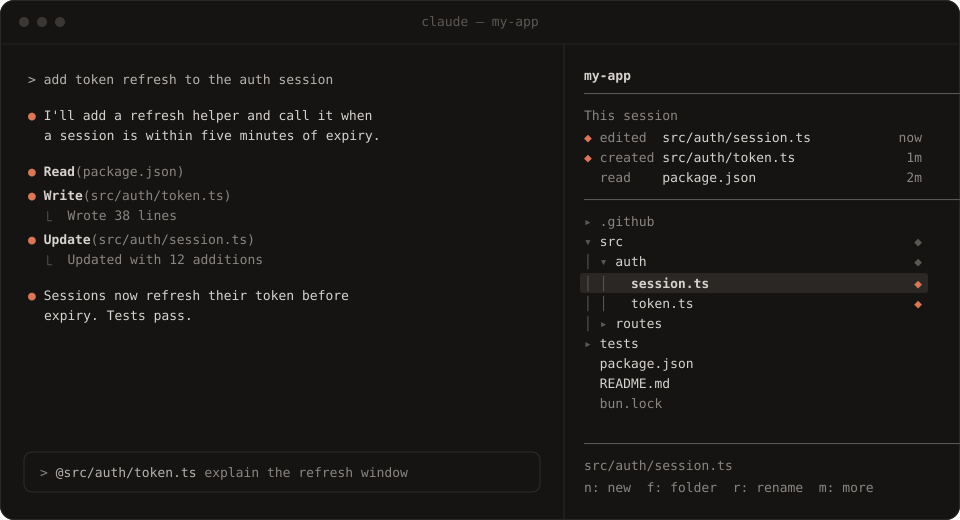

<div align="center">

# Directory

**A file tree that lives beside Claude Code.**<br>
Browse, create, rename and delete files in the same terminal as your Claude session,<br>
and see at a glance what Claude read and changed.

[](https://github.com/umarfarooque88/directory/releases)
[](https://github.com/umarfarooque88/directory/actions/workflows/ci.yml)
[](LICENSE)
[](https://claude.com/claude-code)

<br>



</div>

<br>

## Why

Claude Code lives in the terminal, and the file tree you are used to does not. Directory puts one beside the chat:

- **A real explorer.** Expand folders, create files and folders, rename, delete, copy, cut, paste, open with the default app.
- **A view of Claude's work.** *This session* lists every file Claude read, created and edited, newest first. Changed files carry a `◆` in the tree.
- **A bridge to the prompt.** Enter on a file puts `@path` into your prompt, ready for your next question.

<br>

## Get started

**1. Install Claude Code** — skip if you have it.

```sh
npm install -g @anthropic-ai/claude-code
claude          # sign in once
```

Directory needs Claude Code **2.1.316 or newer**. `claude update` gets you there.

**2. Open your project in Claude.**

```sh
cd your-project
claude
```

**3. Install Directory** — at the Claude prompt, once:

```
/plugin install directory --marketplace umarfarooque88/directory
```

Answer `y` to add the marketplace, then press Enter on **user** scope so Directory loads in every project.
You should see `Installed directory. Plugin is now active.`

<details>
<summary>Prefer a shell, or using the desktop app?</summary>

<br>

From a shell:

```sh
claude plugin install directory --marketplace umarfarooque88/directory
```

In the desktop app: click **+** next to the prompt box, then **Plugins** → **Add marketplace** → `umarfarooque88/directory` → **Add plugin**.

</details>

**4. Open it.**

```
/directory
```

The pane docks beside the chat and takes the keyboard. On a wide terminal, about 144 columns, it opens by itself in every new session.

**5. Stay current.**

```sh
claude plugin update directory
```

<br>

## Keys

While the pane has the keyboard:

| Key | Does |
| :-- | :-- |
| <kbd>↑</kbd> <kbd>↓</kbd> | Move through the tree |
| <kbd>Enter</kbd> | Folder: open or close · File: add `@path` to your prompt |
| <kbd>n</kbd> | New file in the selected folder — `a/b.ts` creates the folders too |
| <kbd>f</kbd> | New folder |
| <kbd>r</kbd> | Rename |
| <kbd>d</kbd> | Delete, after a confirm |
| <kbd>m</kbd> | Show or hide more keys |
| <kbd>c</kbd> <kbd>x</kbd> <kbd>v</kbd> | Copy · cut · paste — a clash pastes as `name copy.ext` |
| <kbd>o</kbd> | Open with the default app |
| <kbd>z</kbd> | Collapse all folders |
| <kbd>u</kbd> | Refresh |
| <kbd>Esc</kbd> | Back to the chat — `/directory` brings you back |

Copy, cut, paste, open, collapse and refresh live on the second row, so press <kbd>m</kbd> first.

<br>

## What you see

```
my-app
────────────────────────────────────────
This session
◆ edited  src/auth/session.ts        now
◆ created src/auth/token.ts           1m
  read    package.json                2m
────────────────────────────────────────
▾ src                                  ◆
│ ▾ auth                               ◆
│ │   session.ts                       ◆
│ │   token.ts                         ◆
▸ tests
  package.json
────────────────────────────────────────
src/auth/session.ts
n: new  f: folder  r: rename  d: delete  m: more
```

- **This session** appears once Claude touches a file. Enter on an entry opens its folders and selects it.
- **`◆`** marks a file Claude created or edited; a dim `◆` marks the folders that hold one.
- **Dim names** are dotfiles, lock files and `node_modules`. `.git` is hidden.
- The tree refreshes after each of Claude's tool calls. Press <kbd>u</kbd> after changing files elsewhere.

<br>

## Good to know

- **Deleting is recoverable on Windows** — items go to the Recycle Bin. On macOS and Linux Directory uses `trash` when it is installed, and deletes permanently otherwise. The confirm says which.
- **File names are never passed through a shell.** On Windows, operations run in PowerShell with paths handed over as environment variables; on macOS and Linux they run `mkdir`, `mv`, `cp` and `rm` directly.
- **Big trees** draw up to 2,000 rows. Press <kbd>z</kbd> to collapse.

<details>
<summary><b>The pane does not open</b></summary>

<br>

- Type `/directory`. Opening it yourself works at any width; opening by itself needs about 144 columns.
- If `/directory` comes back as an ordinary message, the plugin is not loaded. Run `/reload-plugins`, or check `claude plugin list` for `directory` and `✔ enabled`.
- Check `claude --version` is 2.1.316 or newer.

</details>

<details>
<summary><b>Remove Directory</b></summary>

<br>

Run `/plugin`, pick **directory**, then **Uninstall**. Or from a shell: `claude plugin uninstall directory`.

</details>

<br>

## Develop

```sh
git clone https://github.com/umarfarooque88/directory
cd directory
claude --plugin-dir .      # run it from source; saves hot-reload
claude plugin validate .   # what the engine will accept
claude plugin test .       # the test suite
```

The plugin is three pieces: [`hooks/register.tsx`](hooks/register.tsx) draws the pane and handles keys, [`hooks/paths.ts`](hooks/paths.ts) does the path work, and [`types/index.d.ts`](types/index.d.ts) declares the state it keeps. See [CONTRIBUTING.md](CONTRIBUTING.md) before opening a pull request.

<br>

## License

[MIT](LICENSE) © umarfarooque88
